# FakeGPS

[繁體中文說明](README_CN.md)

FakeGPS is a GPS device simulator. It keeps outputting a mock location at the
coordinates you choose, and the floating joystick lets you "walk" around the
map. **No root is required** — it uses the standard Android mock-location API.

> Mock location is a developer feature intended for app testing, privacy
> research, and location-based development. Respect the laws and terms of
> service that apply to the apps and services you use.

## Table of contents

- [Quick start (60 seconds)](#quick-start-60-seconds)
- [Step-by-step guide](#step-by-step-guide)
  - [Step 0 — Before you start](#step-0--before-you-start)
  - [Step 1 — Download and install](#step-1--download-and-install)
  - [Step 2 — Enable Developer options](#step-2--enable-developer-options)
  - [Step 3 — Select FakeGPS as the mock location app](#step-3--select-fakegps-as-the-mock-location-app)
  - [Step 4 — Grant permissions](#step-4--grant-permissions)
  - [Step 5 — Start and verify](#step-5--start-and-verify)
  - [Step 6 — Use the floating joystick](#step-6--use-the-floating-joystick)
  - [Step 6b — Pick a location from the floating window](#step-6b--pick-a-location-from-the-floating-window)
  - [Step 7 — Pick a location on the map](#step-7--pick-a-location-on-the-map)
  - [Step 8 — Flight mode](#step-8--flight-mode)
  - [Step 9 — Bookmarks](#step-9--bookmarks)
  - [Step 10 — Stop](#step-10--stop)
  - [Step 11 — Change language or theme](#step-11--change-language-or-theme)
- [Troubleshooting](#troubleshooting)
- [Accepted coordinate formats](#accepted-coordinate-formats)
- [FAQ](#faq)
- [Build from source](#build-from-source)

## Quick start (60 seconds)

1. Download `FakeGPS_v2.2.1.apk` from the
   [latest release](https://github.com/Miku0139oao/FakeGPS/releases/tag/v2.2.1)
   and install it.
2. Enable **Developer options** (Settings → About phone → tap **Build number**
   seven times).
3. Go to **Settings → System → Developer options → Select mock location app**
   and choose **FakeGPS**.
4. Open FakeGPS, grant **Location**, **Notifications**, and **Display over other
   apps**, then press **Start**.
5. Open Google Maps or any GPS test app and check that your location moved.

## Screenshots

| Main screen | Map picker | Flight mode |
|---|---|---|
| 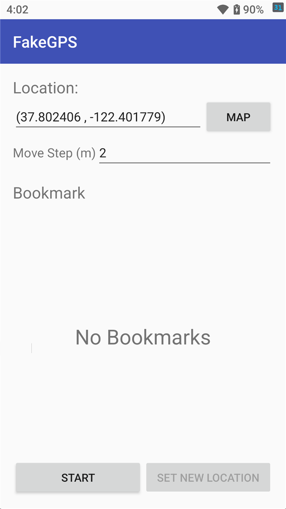 | 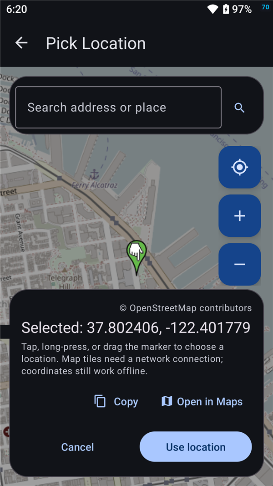 | 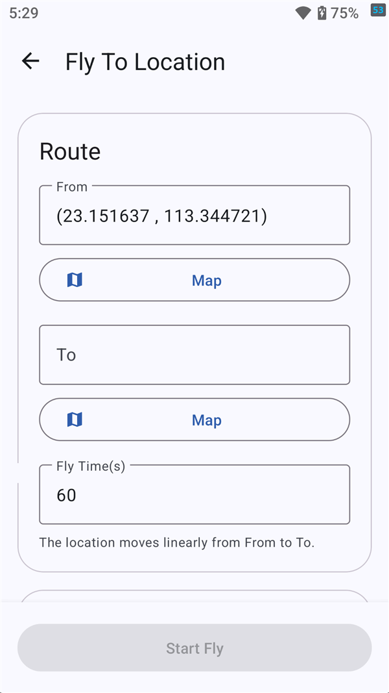 |

| Settings | Address search |
|---|---|
| 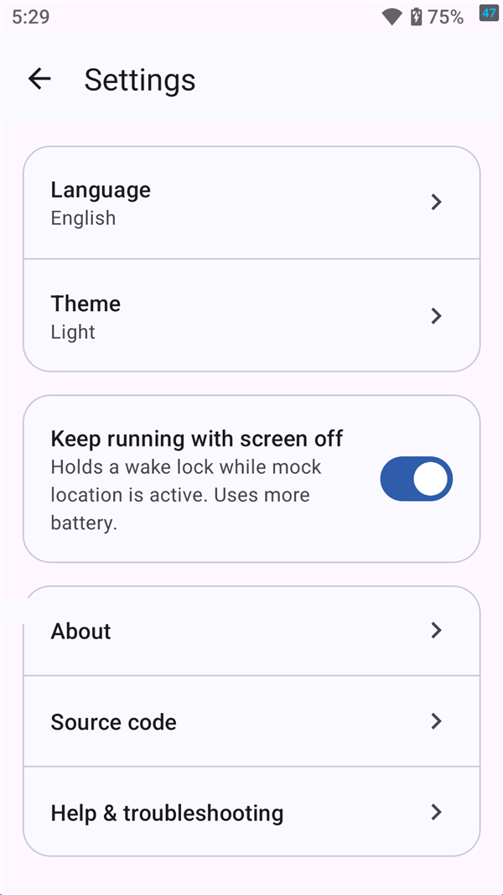 | 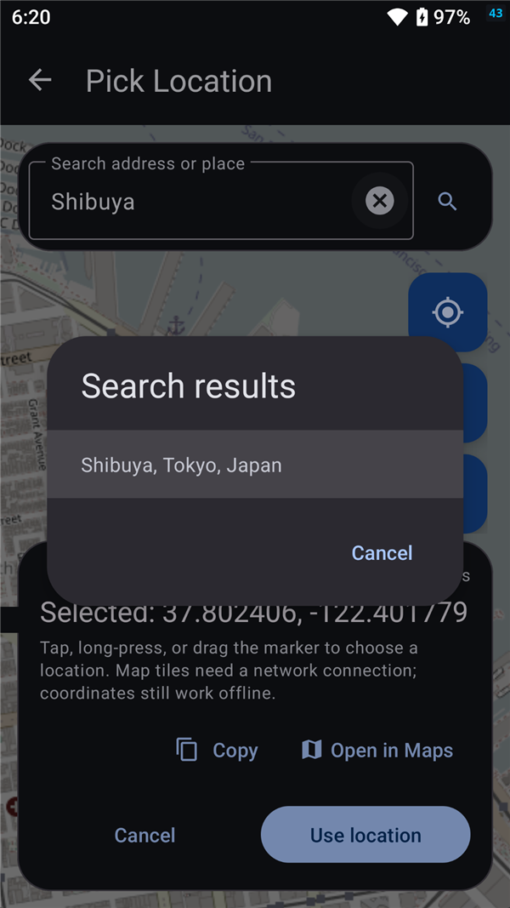 |

| Floating-window picker | Selected point |
|---|---|
| 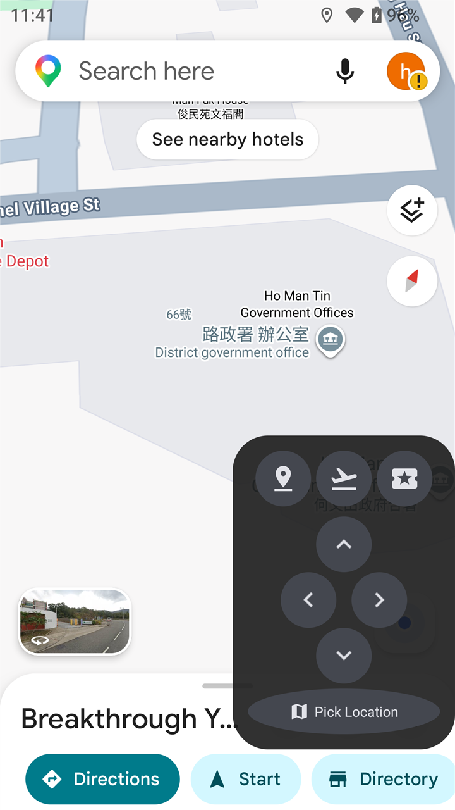 | 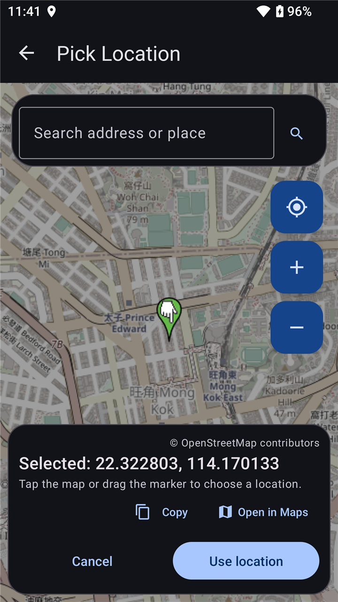 |

## Step-by-step guide

### Step 0 — Before you start

You need:

- An Android phone or tablet running **Android 5.0 (API 21) or newer**
  (tested on Android 16 / API 36).
- The APK from the [Releases page](https://github.com/Miku0139oao/FakeGPS/releases).
- A map or GPS test app to verify the result (Google Maps, GPSTest, etc.).
- **No root access.** Do not install Magisk or modify the system.

Notes:

- The app injects locations through Android's **mock location** developer API.
  The phone itself must be able to run apps and change developer settings.
- Some apps detect the mock flag and may ignore or warn about it. That is a
  property of those apps, not a bug in FakeGPS.
- If your device is managed by a company/school (MDM) or is a work profile, the
  developer-options entry may be locked.

### Step 1 — Download and install

1. Open the [Releases page](https://github.com/Miku0139oao/FakeGPS/releases).
2. Download the signed `FakeGPS_v2.2.1.apk` asset.
3. Tap the downloaded file. If Android blocks it, allow your browser or file
   manager to **install unknown apps**:
   - Android 8+: **Settings → Apps → Special app access → Install unknown apps
     → your browser/file manager → Allow from this source**.
   - Older Android: **Settings → Security → Unknown sources**.
4. If Play Protect says "Unsafe app blocked", choose **More details → Install
   anyway**. The APK is self-signed and distributed on GitHub, not through Play.

**"App not installed" / signature error:** uninstall any older FakeGPS build
signed with a different key, then install this APK. Do not install it over a
copy from another source.

### Step 2 — Enable Developer options

1. Open **Settings → About phone** (on Samsung: **About phone → Software
   information**).
2. Find **Build number** and tap it **seven times**.
3. Enter your PIN/pattern if asked. A toast says "You are now a developer".

OEM paths:

| Brand | Path |
|---|---|
| Pixel / AOSP | Settings → About phone → Build number |
| Samsung | Settings → About phone → Software information → Build number |
| Xiaomi / Redmi / POCO | Settings → About phone → MIUI/HyperOS version (tap 7×) |
| OPPO / OnePlus / realme | Settings → About device → Version → Build number |
| vivo / iQOO | Settings → System management → About phone → Software version |
| Huawei / Honor | Settings → About phone → Build number |

### Step 3 — Select FakeGPS as the mock location app

1. Open **Settings → System → Developer options**.
   (On some phones: **Settings → Developer options**.)
2. Scroll to the **Location** or **Debugging** section and tap
   **Select mock location app**.
3. Choose **FakeGPS**.

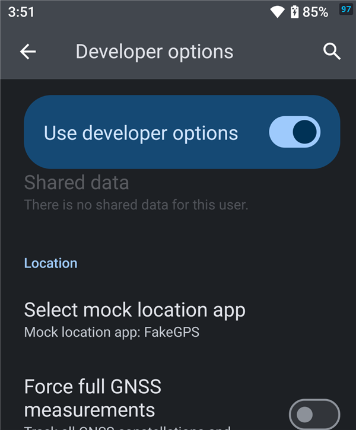

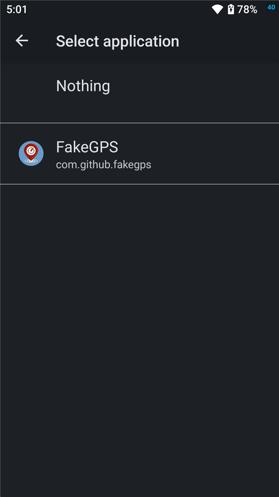

If **FakeGPS is missing from the list**:

- Install the latest APK from this repository. This build declares
  `ACCESS_MOCK_LOCATION` on all API levels — the Android picker filters by that
  permission, and older builds with `maxSdkVersion="22"` could show only
  "Nothing".
- Open FakeGPS once from the app drawer (the picker only updates after the app
  has been launched once).
- Make sure the app is installed for the current user and not disabled.
- Use the magnifier/search icon in Developer options and search for
  "mock location".

### Step 4 — Grant permissions

Open **FakeGPS** from the app drawer. Press **Start** and grant what is asked:

| Permission | Why it is needed |
|---|---|
| **Location** (approximate is enough) | Android 14+ requires a location permission for the location-type foreground service. FakeGPS never reads your real location, so approximate is sufficient. |
| **Notifications** (Android 13+) | Shows the ongoing "FakeGPS Running" notification. The service still runs if you deny it. |
| **Display over other apps** | Draws the floating joystick on top of other apps. This is required. |

If the app explains that it is not the selected mock location app, tap **Open
Settings**, choose FakeGPS, then press **Start** again.


### Step 5 — Start and verify

1. Enter a location in **Location** (for example `37.802406, -122.401779`), or
   tap **MAP** and pick a point.
2. Press **Start**.
3. A persistent notification appears:

   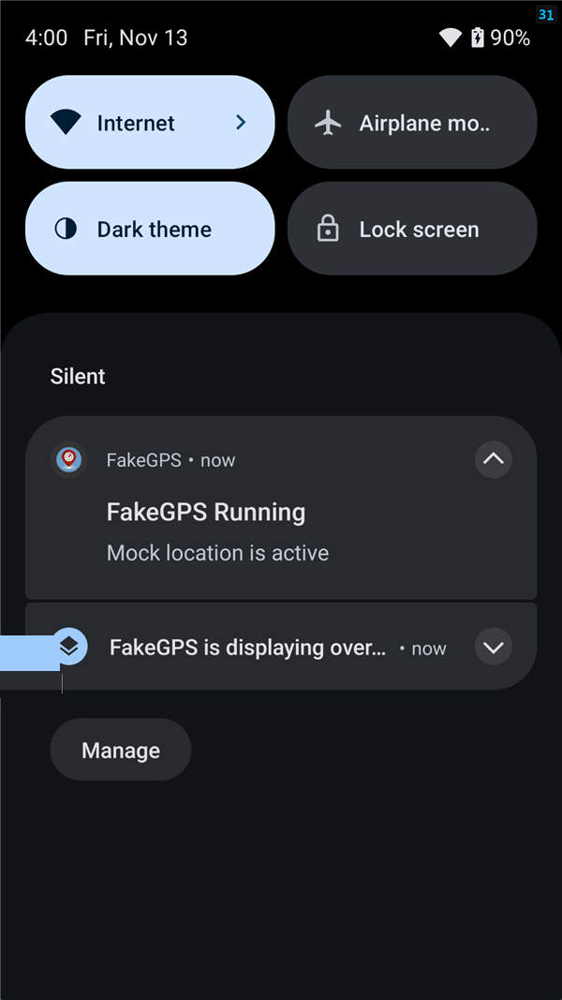

4. Open Google Maps or GPSTest. Your location should now be the mock location.
5. The app closes and the **floating joystick** appears on top of other apps:

   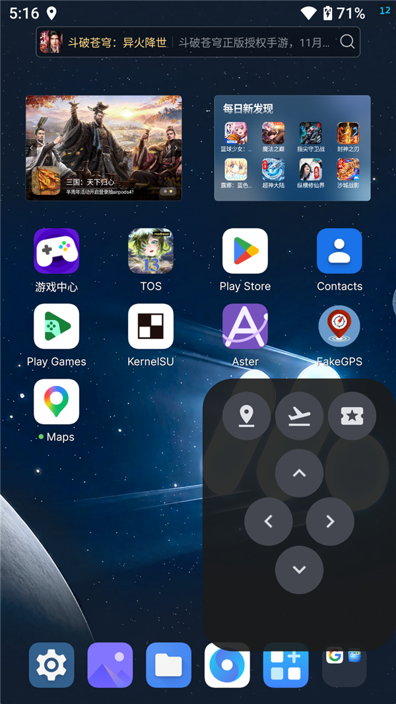

If Maps still shows the real location, see [Troubleshooting](#troubleshooting).

To move the simulation while it is already running, open FakeGPS again and
change anything — the coordinate field plus **Use location** (or the keyboard's
Done key), **MAP** to pick a new point, a bookmark row, or the **Move Step**
buttons. Every one of them is applied immediately; there is no need to stop and
start again.

### Step 6 — Use the floating joystick

The joystick stays on top of other apps. Drag the background to move it
somewhere convenient.

| Button | Action |
|---|---|
| 📍 location pin | Open the FakeGPS main screen (also where you press **Stop**) |
| ✈️ plane | Open flight mode / stop an active flight |
| ⭐ star | Save the current location as a bookmark |
| ⭐ star (long press) | Copy the current coordinates to the clipboard |
| 🗺️ map icon at the bottom | Pick a location directly from the floating window (Step 6b) |
| ▲ ▼ ◀ ▶ | Move the current location by **Move Step** meters |

- **Tap** an arrow to move one step.
- **Long press** an arrow to keep moving every 500 ms.
- `Move Step (m)` is the distance in **meters** (default `2`).
- Movement is converted with a latitude-aware longitude scale, so it works near
  the poles too.

> While mock location is running, FakeGPS holds a partial wake lock so the
> once-per-second injection keeps working with the screen off. Press **Stop**
> when you are done to release it and save battery.

### Step 6b — Pick a location from the floating window

You can move the mock location without leaving Google Maps.

1. Start mock location, then switch to Google Maps or any other app.
2. Tap **Pick Location** at the bottom of the floating panel (the map icon).
3. Pan/zoom the map, tap the target place (or search for it), then tap
   **Use location**.
4. The new point is applied immediately and you return to the previous app.
5. While FakeGPS's own screens are open, the floating panel is hidden; it comes
   back when you return to another app.


> The panel can still be dragged, but it is kept inside the screen edges. On
> the v2.2.0 build the overlay button label is shown in English; the map icon
> and position are the same in every language.

### Step 7 — Pick a location on the map

1. On the main or flight screen, tap **MAP** next to a location field.
2. **Search by address or place** in the search bar at the top (for example
   `Shibuya, Tokyo`). Android's Geocoder is used first, with OpenStreetMap
   Nominatim as a fallback. No API key is required; both need a network.
3. Tap a result to move the marker and camera to that place.
4. Pan/zoom the map, then **tap**, **long-press**, or **drag the marker**.
5. The bottom panel shows the selected coordinates.
6. Tap **Use location**. While the simulation is running the point is applied
   immediately; when it is stopped the field is only filled, and **Start**
   begins there. **Cancel** goes back without changing anything.


- Search results come from Android's geocoder or OpenStreetMap Nominatim.
- Use the **+ / −** buttons to zoom and the crosshair button to recenter on the
  marker. **Copy** copies the selected coordinates; **Open in Maps** opens the
  point with another map app (`geo:` URI). The **X** in the search field clears
  it.
- The map uses a dimmed, desaturated tile filter in dark mode.
- Map tiles come from **OpenStreetMap** and need a network connection.
- The coordinates still work offline; if tiles cannot load, you can type a
  coordinate or use the map position.
- Attribution: © OpenStreetMap contributors.

### Step 8 — Flight mode

1. Tap the **plane** button on the joystick.
2. Fill in **From** and **To** (each has its own **MAP** button).
3. Set **Fly Time(s)** to the duration in seconds (default 60).
4. Press **Start Fly**. The location moves **linearly** from From to To over
   that time; press **Stop Fly** to stop early.
5. The app must already be running (mock location started) before flight mode
   works.


### Step 9 — Bookmarks

- **Save:** tap the star button on the floating panel, or **Save current
  location** on the main screen. The place is saved immediately with a
  coordinate name such as `22.3726, 114.1797`; saving the same place twice is
  skipped.
- **Rename:** tap **⋮** on the row and choose **Rename**.
- **Use:** while the mock is running, tap a bookmark in the list to jump there.
- **Delete:** tap **⋮ → Delete** (long-press works too) and confirm.
- Bookmarks are stored locally in the app's database. Auto backup is disabled.

### Step 10 — Stop

Use any of these:

1. Tap the **location pin** on the joystick → press **Stop**.
2. Open the FakeGPS notification → stop the service from there.
3. **Settings → Apps → FakeGPS → Force stop** (last resort).
4. Reboot the phone.

After stopping, the floating joystick disappears and the mock location is
removed. The app may keep the last coordinates for the next launch.

### Step 11 — Change language or theme

Tap the **gear icon** in the top-right corner of the main screen. Settings lets
you change:

- **Language** — System default, English, 繁體中文, 简体中文, 日本語, 한국어,
  Español, Français, Deutsch, Português (Brasil). The choice is applied
  immediately and remembered. On Android 13+ it also appears in the system
  per-app language settings.
- **Theme** — Follow system, Light, or Dark.
- **Keep running with screen off** — holds a partial wake lock while mock
  location is active (uses more battery). Turn it off if you prefer the
  injection loop to pause when the device sleeps.


The same screen links to the source code and the troubleshooting guide, and
shows the About dialog with the version and OpenStreetMap attribution.

## What's new in v2.2.1

- **Redesigned screens**: the main screen, floating joystick, map picker and
  settings share one Material 3 surface/typography system; the joystick's arrow
  buttons are 48 dp with haptic feedback.
- **Bookmarks in one tap**: save from the main screen or the floating panel
  without opening a naming dialog. The place is named after its coordinates and
  duplicates are skipped; **⋮ → Rename / Delete** replaces the hidden
  long-press gesture.
- **Names that survive language switches**: legacy "Bookmark" rows show their
  coordinates in all 9 languages, and a failed rename is reported instead of
  silently reverting.
- **The app remembers where you were**: after a stop, a restart or a crash the
  main screen offers the last started location instead of the sample location
  in San Francisco; a fresh install falls back to the phone's own last known
  position when the location permission is granted.
- **Full-width coordinates**: Chinese IMEs that type `。`/`，` are normalized,
  so `22。37139，114。17833` works.
- **Stopping keeps the screen open**, and overlay toasts/notifications follow
  the language picked in Settings.
- **The floating panel can be turned off** in Settings. Some apps and browsers
  refuse to show a permission prompt while another app draws over the screen;
  turning the panel off keeps mock location running without the overlay.
- **Browsers see the fake location**: the engine now overrides Android's
  `fused` provider as well as GPS and network, so Chrome, Edge, Samsung
  Internet, vivo Browser and Google Play Services report the mocked position
  instead of the real one. The "Display over other apps" permission is also no
  longer required when the floating panel is off.
- **Background execution help**: Settings → Behavior → Background execution
  opens the right screen for the phone (vivo/iQOO, Xiaomi/Redmi/POCO,
  OPPO/realme/OnePlus, Huawei/Honor, Samsung) or the system battery dialog, so
  the mock keeps running while another app is in front.

## What's new in v2.2.0

- **100% Kotlin**: the app and tests were migrated from Java to Kotlin (0 Java
  files, 61 JVM tests) without changing the database, preferences, or Android
  5.0–16 support.
- **Floating-window map picker**: the **Pick Location** button opens the map,
  applies the selected point instantly, and returns to the previous app.
- **Overlay UX**: the joystick hides on FakeGPS's own screens, the picker card
  is compact, and the panel is clamped inside the screen.
- **Data compatibility**: existing `fake_gps.db` bookmarks and settings upgrade
  in place (verified on Android 15).
- **R8 release**: 2,280,521 bytes, signed release APK.

### From v2.1.0

- **Material 3 UI**: status card, outlined inputs, card-based bookmarks, bottom
  action bar, floating map controls, and a modern floating joystick.
- **In-app language picker with 9 locales** (English, 繁體中文, 简体中文, 日本語,
  한국어, Español, Français, Deutsch, Português (Brasil)) plus system default.
- **Settings screen**: language, light/dark/system theme, wake-lock preference,
  source/help links, and About.
- **Address/place search** on the map: Android Geocoder first, OpenStreetMap
  Nominatim fallback, no API key. Pick a result to move the marker.
- **Mock-app picker fix**: `ACCESS_MOCK_LOCATION` is now declared on all API
  levels. The Android 15/16 picker filters by that permission, so builds with
  `maxSdkVersion="22"` could show only "Nothing"; FakeGPS now appears.
- **Android 16 ready**: compileSdk/targetSdk 36, AGP 8.13.2, Gradle 8.14.7.
- Edge-to-edge system-bar and IME insets; no more content under the status bar,
  navigation bar, or keyboard.
- Real speed/bearing, meter-based Move Step, `geo:`/map-link/DMS input,
  R8-minified release APK (~1 MB), and a hardened CI pipeline.

## Troubleshooting

| Symptom | What to check |
|---|---|
| The app says "FakeGPS Running" but Maps does not move | Is FakeGPS selected in **Developer options → Select mock location app**? Open Developer options and check the line under the entry. Then force-stop and start FakeGPS again. |
| "Select mock location app" is missing or greyed out | Developer options are off, the device is managed by an MDM/work profile, or the ROM hides it. Try the Settings search icon and type "mock location". |
| The floating joystick does not appear | Check that the **Floating panel** switch in Settings is on, then grant **Display over other apps** for FakeGPS. On MIUI/EMUI also enable "Display pop-up windows while running in background" and disable battery restrictions for FakeGPS. |
| The notification is missing | Grant **Notifications** (Android 13+). The foreground service can still run without it, but Android may be more aggressive about killing the process. |
| The map is blank | The phone has no network, OSM tiles are blocked, or the cache is empty. Move the map/zoom out; coordinate entry still works offline. |
| "Input is not valid" | Use `lat, lon`, a `geo:` URI, a Google/Apple Maps link, or a DMS string. Latitude must be −90…90, longitude −180…180. |
| Flight mode does not move | Start mock location first. Check that From/To are valid and Fly Time is a positive integer. |
| It works for a while, then stops | Disable battery optimization for FakeGPS: **Settings → Apps → FakeGPS → Battery → Unrestricted**. On Xiaomi/OPPO/vivo also allow auto-start and background activity. FakeGPS's **Settings → Behavior → Background execution** opens the vendor screen directly. |
| Android 12+ only offers "Approximate" location | That is fine. FakeGPS never reads your real location; approximate is enough for the foreground service. |
| The app is killed when the screen is off | Some OEMs kill foreground services anyway. Open **Settings → Behavior → Background execution** and allow FakeGPS there, lock the app in the recent-apps screen, and keep the notification visible. |
| "App not installed" | Uninstall an older copy signed with a different key and install the release APK again. |
| Google Maps still shows the real location | Make sure mock location is running and restart Maps. If another app still shows the real position, allow background execution for FakeGPS; if the phone freezes the app, the mock stops and every app falls back to the real location. |

## Accepted coordinate formats

All of these work in the **Location**, **From**, and **To** fields:

| Format | Example |
|---|---|
| Decimal degrees | `37.802406, -122.401779` |
| Parentheses (copied from the app) | `(37.802406 , -122.401779)` |
| `geo:` URI | `geo:37.802406,-122.401779` |
| `geo:` URI with a label/zoom | `geo:37.802406,-122.401779?z=15` |
| Google Maps `@` link | `https://www.google.com/maps/@37.802406,-122.401779,15z` |
| Google Maps `q=` link | `https://maps.google.com/?q=37.802406,-122.401779` |
| DMS (degrees/minutes/seconds) | `37°48'8.7"N 122°24'6.4"W` |

Copy a location from the joystick with a long press on the star button, then
paste it into another app or send it to a friend.

## FAQ

**Do I need root?**
No. FakeGPS v2.0+ uses the public `addTestProvider` / `setTestProviderLocation`
API. The only setup is selecting it in Developer options.

**Does it modify the real GPS hardware?**
No. It registers a test provider and feeds it coordinates. Other apps that use
the standard location APIs see the mock location; the real hardware is
untouched.

**Why do some apps still show my real location?**
They may use their own location source, cache aggressively, or reject mock
locations. Test with GPSTest first; if GPSTest moves but a specific app does
not, that app is filtering mock data.

**Does it work with Google Maps?**
Usually yes, when FakeGPS is selected as the mock location app. If Maps does
not update, restart Maps after starting FakeGPS and check the troubleshooting
table.

**Is my data uploaded?**
No account, no analytics, no telemetry. Map tiles are requested from the
OpenStreetMap tile server, which needs a network connection. Address searches
are sent to Android's geocoder or OpenStreetMap Nominatim when you use the map
search bar; no account is involved. Bookmarks and last coordinates stay on the
device; automatic backup is disabled.

**Can I use it on a work/school phone?**
Do not bypass MDM or employer restrictions. Developer options may be disabled
by policy.

**Where are the logs?**
Release builds do not write coordinate logs. Debug builds write to the app's
internal files directory for troubleshooting.

## Build from source

Requires JDK 17+ (JDK 21 recommended) and Android SDK Platform 36.

```bash
./gradlew assembleDebug
```

APK output: `app/build/outputs/apk/debug/FakeGPS_v2.2.1.apk`

CI runs lint, JVM unit tests, and a debug build on every push and pull request
(`.github/workflows/android.yml`).

### Release signing

Release builds read `keystore.properties` from the project root (git-ignored):

```properties
storeFile=/absolute/path/to/fakegps-release.jks
storePassword=...
keyAlias=...
keyPassword=...
```

Keep the keystore and this file outside version control. Verify the result with
`apksigner verify --print-certs app/build/outputs/apk/release/FakeGPS_v2.2.1.apk`.

## Features

- Modern **Material 3** UI with light and dark themes.
- **9 languages** with an in-app picker and Android 13+ per-app language support.
- Simulates a GPS device and outputs a location every second.
- **Jump mode**: jump to a new location instantly.
- **Flight mode**: move linearly from one coordinate to another over a chosen
  duration, with real elapsed-time interpolation.
- Floating joystick with meter-based movement; tap or long-press the arrows.
- **Pick a location directly from the floating window** and apply it instantly,
  returning to the previous app.
- Bookmarks with tap-to-use and long-press-to-delete.
- Visual map picker (OpenStreetMap, no API key, no Google Play Services), with
  address/place search via Android Geocoder or Nominatim.
- Real speed and bearing derived from consecutive fixes.
- Coordinate input from plain text, `geo:` URIs, map links, and DMS.
- Works on Android 5.0–16 (API 21–36), targetSdk 36, edge-to-edge.
- Light and dark themes (follows the system setting).
- R8-minified release APK (about 1 MB).
- No root, no analytics, no account.

## Project layout

```
app/                      Android app (Kotlin)
  src/main/java/...       Kotlin sources: Activities, service, location engine, map picker
  src/main/res/           Layouts, strings (9 locales), drawables
  src/test/java/...       JVM unit tests (Kotlin)
loggerlibrary/            Small file-logger module
screenshot/               Screenshots and tutorial images
.github/workflows/        CI: lint + unit tests + debug build
```

## Contribute

Fork the repository, create a branch, run `./gradlew lintDebug
testDebugUnitTest assembleDebug`, and send a pull request. Please keep new UI
strings in `values/strings.xml` and `values-zh-rTW/strings.xml`, and add a unit
test for new pure-Kotlin logic.

## License

[The MIT License (MIT)](http://opensource.org/licenses/MIT)
