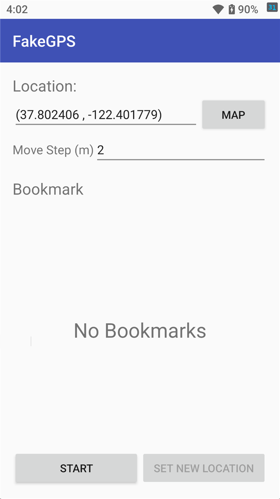
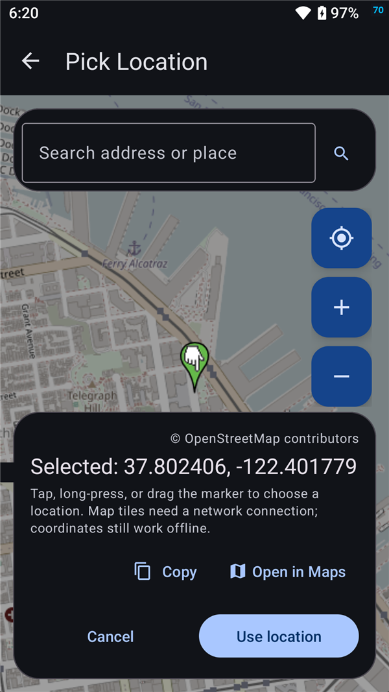
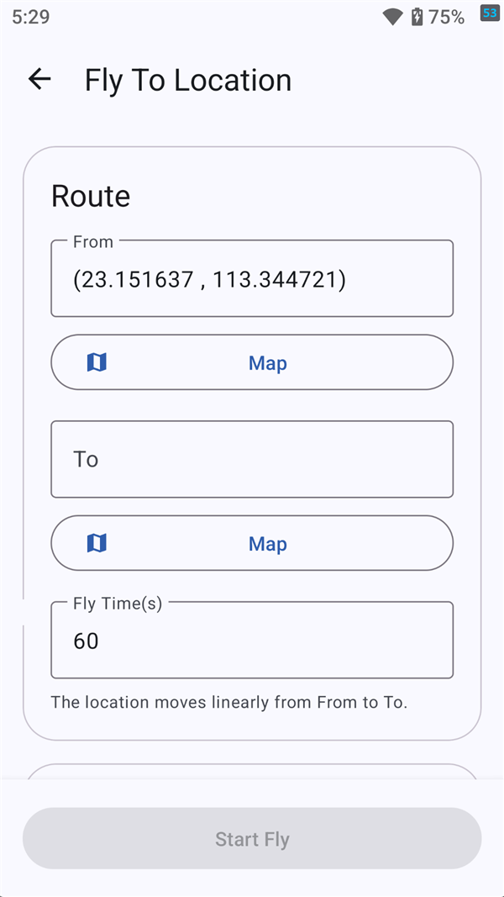
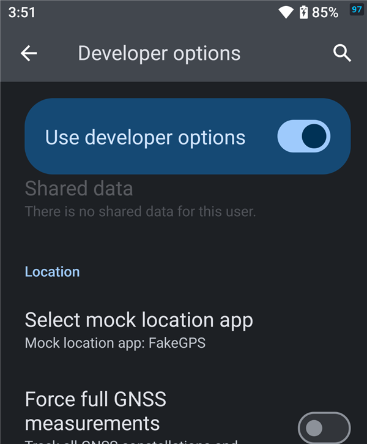
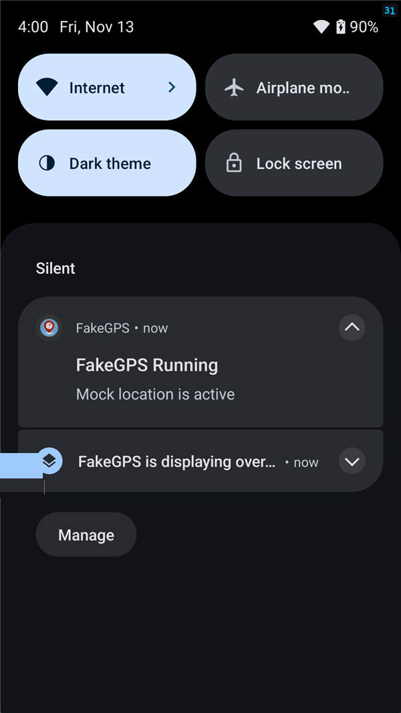
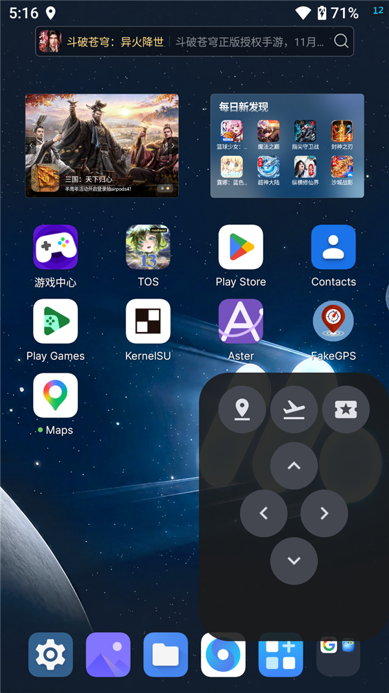

# FakeGPS

[English README](README.md)

FakeGPS 是一個 GPS 模擬器：它會依照你指定的座標持續輸出模擬定位，並提供全域浮動搖桿，讓你在地圖上「走路」。**不需要 root**，使用的是 Android 標準的 mock location 開發者 API。

> 模擬定位是開發者功能，適合 App 測試、隱私研究與位置相關開發。請遵守你使用的 App 與服務的條款及當地法律。

## 目錄

- [60 秒快速開始](#60-秒快速開始)
- [保姆級逐步教學](#保姆級逐步教學)
  - [步驟 0 — 開始前準備](#步驟-0--開始前準備)
  - [步驟 1 — 下載與安裝](#步驟-1--下載與安裝)
  - [步驟 2 — 開啟開發人員選項](#步驟-2--開啟開發人員選項)
  - [步驟 3 — 把 FakeGPS 設為模擬定位應用程式](#步驟-3--把-fakegps-設為模擬定位應用程式)
  - [步驟 4 — 授予權限](#步驟-4--授予權限)
  - [步驟 5 — 啟動並驗證](#步驟-5--啟動並驗證)
  - [步驟 6 — 使用浮動搖桿](#步驟-6--使用浮動搖桿)
  - [步驟 7 — 在地圖上選點](#步驟-7--在地圖上選點)
  - [步驟 8 — 飛行模式](#步驟-8--飛行模式)
  - [步驟 9 — 書籤](#步驟-9--書籤)
  - [步驟 10 — 停止](#步驟-10--停止)
- [疑難排解](#疑難排解)
- [支援的座標格式](#支援的座標格式)
- [常見問題](#常見問題)
- [從原始碼編譯](#從原始碼編譯)

## 60 秒快速開始

1. 從 [最新 Release](https://github.com/Miku0139oao/FakeGPS/releases/tag/v2.1.0) 下載 `FakeGPS_v2.1.0.apk` 並安裝。
2. 開啟 **開發人員選項**（設定 → 關於手機 → 連續點擊 **版本號碼** 7 次）。
3. 到 **設定 → 系統 → 開發人員選項 → 選取模擬定位應用程式**，選擇 **FakeGPS**。
4. 開啟 FakeGPS，允許 **位置**、**通知**、**顯示在其他應用程式上層**，然後按 **Start**。
5. 開啟 Google 地圖或任何 GPS 測試 App，確認位置已變成你設定的座標。

## 截圖

| 主畫面 | 地圖選點 | 飛行模式 |
|---|---|---|
|  |  |  |

## 保姆級逐步教學

### 步驟 0 — 開始前準備

你需要：

- 一台 **Android 5.0（API 21）以上**的手機或平板（已在 Android 16 / API 36 測試）。
- 從 [Releases 頁面](https://github.com/Miku0139oao/FakeGPS/releases) 下載的 APK。
- 一個用來驗證的地圖或 GPS App（Google 地圖、GPSTest 等）。
- **不需要 root**，也不需要 Magisk 或修改系統。

注意：

- FakeGPS 透過 Android 的 **mock location** 開發者 API 注入位置；手機本身必須能安裝 App 並修改開發人員設定。
- 有些 App 會偵測 mock flag 而忽略或警告，這是那些 App 的行為，不是 FakeGPS 的 bug。
- 如果手機由公司／學校的 MDM 管理，或使用工作設定檔，開發人員選項可能被鎖住。

### 步驟 1 — 下載與安裝

1. 開啟 [Releases 頁面](https://github.com/Miku0139oao/FakeGPS/releases)。
2. 下載已簽章的 `FakeGPS_v2.1.0.apk`。
3. 點擊下載的檔案。若 Android 阻止安裝，請允許瀏覽器或檔案管理器「安裝未知的應用程式」：
   - Android 8+：**設定 → 應用程式 → 特殊應用程式存取權 → 安裝未知的應用程式 → 你的瀏覽器／檔案管理器 → 允許來自此來源**。
   - 較舊的 Android：**設定 → 安全性 → 未知的來源**。
4. 若 Play Protect 顯示「不安全的應用程式已封鎖」，選 **更多詳細資料 → 仍要安裝**。這個 APK 是自簽章、從 GitHub 發佈，不是透過 Play 商店。

**「應用程式未安裝」／簽章錯誤：** 先解除安裝任何用不同金鑰簽署的舊版 FakeGPS，再安裝這個 APK。不要覆蓋安裝其他來源的版本。

### 步驟 2 — 開啟開發人員選項

1. 開啟 **設定 → 關於手機**（三星：**關於手機 → 軟體資訊**）。
2. 找到 **版本號碼**，連續點擊 **7 次**。
3. 如果要求，輸入 PIN／圖形鎖。畫面會提示「您現在是開發人員」。

各品牌路徑：

| 品牌 | 路徑 |
|---|---|
| Pixel / AOSP | 設定 → 關於手機 → 版本號碼 |
| 三星 | 設定 → 關於手機 → 軟體資訊 → 版本號碼 |
| 小米 / Redmi / POCO | 設定 → 關於手機 → MIUI/HyperOS 版本（點 7 次） |
| OPPO / OnePlus / realme | 設定 → 關於裝置 → 版本 → 版本號碼 |
| vivo / iQOO | 設定 → 系統管理 → 關於手機 → 軟體版本 |
| 華為 / 榮耀 | 設定 → 關於手機 → 版本號碼 |

### 步驟 3 — 把 FakeGPS 設為模擬定位應用程式

1. 開啟 **設定 → 系統 → 開發人員選項**（部分手機是 **設定 → 開發人員選項**）。
2. 捲到 **位置** 或 **偵錯** 區塊，點擊 **選取模擬定位應用程式**。
3. 選擇 **FakeGPS**。



如果清單中**找不到 FakeGPS**：

- 先從應用程式抽屜開啟 FakeGPS 一次（清單通常要等 App 啟動過才會更新）。
- 確認 App 已安裝在目前使用者，且沒有被停用。
- 使用開發人員選項右上角的搜尋圖示，輸入「模擬定位」。
- 部分 ROM 要完全開啟開發人員選項後才會顯示此項目。

> 上圖來自測試模擬器；一般手機的選單會列出 FakeGPS。

### 步驟 4 — 授予權限

從應用程式抽屜開啟 **FakeGPS**，按 **Start**，依照提示授予：

| 權限 | 用途 |
|---|---|
| **位置**（「大約」即可） | Android 14+ 的 location 類型前景服務需要位置權限。FakeGPS 不會讀取你的真實位置，因此「大約」就足夠。 |
| **通知**（Android 13+） | 顯示「FakeGPS 執行中」的常駐通知。拒絕的話服務仍可運作。 |
| **顯示在其他應用程式上層** | 顯示浮動搖桿，**必須授予**。 |

如果 App 提示尚未被選為模擬定位應用程式，點 **開啟設定**，選擇 FakeGPS，再按一次 **Start**。


### 步驟 5 — 啟動並驗證

1. 在 **Location** 輸入座標（例如 `37.802406, -122.401779`），或按 **MAP** 選點。
2. 按 **Start**。
3. 通知欄會出現常駐通知：

   

4. 開啟 Google 地圖或 GPSTest，位置應該會變成模擬座標。
5. App 會關閉，並在其他 App 上方顯示 **浮動搖桿**：

   

如果地圖仍顯示真實位置，請看 [疑難排解](#疑難排解)。

### 步驟 6 — 使用浮動搖桿

搖桿會停留在其他 App 上方。拖曳背景可以移動它的位置。

| 按鈕 | 動作 |
|---|---|
| 📍 定位圖示 | 開啟 FakeGPS 主畫面（也是按 **Stop** 的地方） |
| ✈️ 飛機 | 開啟飛行模式／停止飛行 |
| ⭐ 星星 | 將目前位置存成書籤 |
| ⭐ 星星（長按） | 複製目前座標到剪貼簿 |
| ▲ ▼ ◀ ▶ | 依 **Move Step** 公尺數移動目前位置 |

- **點一下**方向鍵：移動一步。
- **長按**方向鍵：每 500 毫秒連續移動。
- `Move Step (m)` 的單位是 **公尺**（預設 `2`）。
- 移動會依緯度換算經度比例，靠近極區也能正確運作。

> 模擬定位執行期間，FakeGPS 會持有 partial wake lock，讓螢幕關閉時仍能每秒注入位置。不使用時請按 **Stop** 釋放，節省電量。

### 步驟 7 — 在地圖上選點

1. 在主畫面或飛行畫面，點擊座標欄位旁的 **MAP**。
2. 拖曳／縮放地圖，然後 **點擊**、**長按** 或 **拖曳 marker**。
3. 底部面板會顯示目前選取的座標。
4. 按 **Use this location** 回填欄位，或按 **Cancel** 返回。


- 地圖圖磚來自 **OpenStreetMap**，需要網路連線。
- 沒有網路時仍可輸入座標或使用目前的地圖位置。
- 標示：© OpenStreetMap 貢獻者。

### 步驟 8 — 飛行模式

1. 點擊搖桿上的 **飛機** 按鈕。
2. 填入 **From** 和 **To**（兩者都有各自的 **MAP** 按鈕）。
3. 設定 **Fly Time(s)**（秒，預設 60）。
4. 按 **Start Fly**：位置會在指定時間內從 From **線性**移動到 To；按 **Stop Fly** 可提前停止。
5. 使用前必須先啟動 mock location（按過 Start）。


### 步驟 9 — 書籤

- **儲存：** 長按搖桿上的星星按鈕，輸入名稱，按 **Save**。
- **使用：** 開啟主畫面，點擊清單中的書籤。
- **刪除：** 長按清單中的書籤並確認。
- 書籤儲存在 App 本機資料庫；自動備份已關閉。

### 步驟 10 — 停止

任選一種：

1. 點擊搖桿上的 **定位圖示** → 按 **Stop**。
2. 開啟 FakeGPS 通知 → 從通知停止服務。
3. **設定 → 應用程式 → FakeGPS → 強制停止**（最後手段）。
4. 重新開機。

停止後浮動搖桿會消失，模擬定位也會移除。App 可能會保留最後的座標供下次開啟使用。

## 疑難排解

| 症狀 | 檢查方式 |
|---|---|
| 顯示「FakeGPS 執行中」，但地圖不會動 | 是否已在 **開發人員選項 → 選取模擬定位應用程式** 選了 FakeGPS？確認該項目下方的文字，然後強制停止並重新啟動 FakeGPS。 |
| 找不到「選取模擬定位應用程式」或它是灰色的 | 開發人員選項沒開、裝置受 MDM／工作設定檔管理，或 ROM 隱藏了它。用設定內的搜尋圖示輸入「模擬定位」。 |
| 浮動搖桿沒有出現 | 授予 **顯示在其他應用程式上層**。小米／華為等還要開啟「背景彈出視窗」並關閉 FakeGPS 的電池限制。 |
| 沒有通知 | 授予 **通知** 權限（Android 13+）。沒有通知前台服務仍可運作，但系統可能更積極殺掉進程。 |
| 地圖一片空白 | 手機沒網路、OSM 圖磚被封鎖，或快取是空的。移動／縮小地圖；離線時仍可手動輸入座標。 |
| 顯示「輸入無效」 | 使用 `緯度, 經度`、`geo:` URI、Google/Apple 地圖連結或 DMS 字串。緯度 −90…90，經度 −180…180。 |
| 飛行模式不會動 | 先啟動 mock location。確認 From/To 有效，Fly Time 是正整數。 |
| 用一陣子後停止 | 關閉 FakeGPS 的電池最佳化：**設定 → 應用程式 → FakeGPS → 電池 → 不受限制**。小米／OPPO／vivo 還要允許自啟動與背景活動。 |
| Android 12+ 只提供「大約」位置 | 沒問題。FakeGPS 不會讀取真實位置，「大約」已足夠 foreground service 使用。 |
| 螢幕關閉後 App 被殺 | 部分品牌會殺掉前台服務。在最近使用畫面鎖定 App，關閉電池限制，並保留通知。 |
| 「應用程式未安裝」 | 解除安裝不同簽章的舊版，再安裝 Release APK。 |
| Google 地圖仍顯示真實位置 | 有些 App 會快取位置或偏好其他來源。先用 GPSTest 測試；切換 GPS 開關；重啟 App；確認 mock app 設定仍在。 |

## 支援的座標格式

以下格式都可以用在 **Location**、**From**、**To** 欄位：

| 格式 | 範例 |
|---|---|
| 十進位度 | `37.802406, -122.401779` |
| 括號格式（App 複製出來的） | `(37.802406 , -122.401779)` |
| `geo:` URI | `geo:37.802406,-122.401779` |
| `geo:` URI 加標籤／縮放 | `geo:37.802406,-122.401779?z=15` |
| Google 地圖 `@` 連結 | `https://www.google.com/maps/@37.802406,-122.401779,15z` |
| Google 地圖 `q=` 連結 | `https://maps.google.com/?q=37.802406,-122.401779` |
| DMS（度分秒） | `37°48'8.7"N 122°24'6.4"W` |

長按搖桿上的星星按鈕可複製目前位置，再貼到其他 App 或傳給朋友。

## 常見問題

**需要 root 嗎？**
不需要。FakeGPS v2.0+ 使用公開的 `addTestProvider` / `setTestProviderLocation` API，唯一設定是在開發人員選項中選取它。

**會修改真實 GPS 硬體嗎？**
不會。它註冊一個測試 provider 並餵入座標；使用標準定位 API 的 App 會看到模擬位置，真實硬體不受影響。

**為什麼有些 App 還是顯示真實位置？**
它們可能使用自己的位置來源、快取很積極，或拒絕 mock location。先用 GPSTest 測試；如果 GPSTest 會動但特定 App 不會，就是該 App 過濾了模擬資料。

**Google 地圖可以用嗎？**
通常可以，只要 FakeGPS 已被選為模擬定位應用程式。如果地圖不更新，啟動 FakeGPS 後重啟地圖，並查看疑難排解。

**我的資料會被上傳嗎？**
沒有帳號、沒有分析、沒有遙測。地圖圖磚會向 OpenStreetMap 圖磚伺服器請求，因此需要網路。書籤與最後座標只留在裝置上，自動備份已關閉。

**可以在公司／學校手機上用嗎？**
不要繞過 MDM 或雇主限制。開發人員選項可能被政策鎖住。

**日誌在哪裡？**
Release 版本不寫座標日誌。Debug 版本會寫到 App 的內部檔案目錄，方便排錯。

## 從原始碼編譯

需要 JDK 17+（建議 JDK 21）與 Android SDK Platform 36。

```bash
./gradlew assembleDebug
```

APK 輸出：`app/build/outputs/apk/debug/FakeGPS_v2.1.0.apk`

CI 會在每次 push 與 pull request 執行 lint、JVM 單元測試與 debug build
（`.github/workflows/android.yml`）。

### Release 簽章

Release build 會讀取專案根目錄的 `keystore.properties`（已 gitignore）：

```properties
storeFile=/absolute/path/to/fakegps-release.jks
storePassword=...
keyAlias=...
keyPassword=...
```

請把 keystore 與這個檔案放在版本控制之外。用
`apksigner verify --print-certs app/build/outputs/apk/release/FakeGPS_v2.1.0.apk`
驗證結果。

## 功能列表

- 模擬 GPS 裝置，每秒輸出定位。
- **跳變模式**：立即跳到新座標。
- **飛行模式**：在指定時間內以真實經過時間做線性插值。
- 浮動搖桿，以公尺為單位移動；點擊或長按方向鍵。
- 書籤：點擊使用、長按刪除。
- 視覺化地圖選點（OpenStreetMap，不需 API key、不需 Google Play Services）。
- 由連續定位計算真實 speed / bearing。
- 座標輸入支援純文字、`geo:` URI、地圖連結與 DMS。
- 支援 Android 5.0–16（API 21–36）、targetSdk 36、edge-to-edge。
- 淺色／深色主題（跟隨系統設定）。
- R8 壓縮後的 release APK（約 1 MB）。
- 不需要 root，沒有分析、沒有帳號。

## 專案結構

```
app/                      Android App（Java）
  src/main/java/...       Activity、Service、LocationThread、地圖選點
  src/main/res/           版面、字串（en + zh-rTW）、圖示
  src/test/java/...       JVM 單元測試
loggerlibrary/            小型檔案日誌模組
screenshot/               截圖與教程圖片
.github/workflows/        CI：lint + 單元測試 + debug build
```

## 貢獻

歡迎 fork、開分支、執行 `./gradlew lintDebug testDebugUnitTest
assembleDebug`，然後發 Pull Request。新增 UI 字串請同時更新
`values/strings.xml` 與 `values-zh-rTW/strings.xml`，新的純 Java 邏輯請補單元測試。

## License

[The MIT License (MIT)](http://opensource.org/licenses/MIT)
