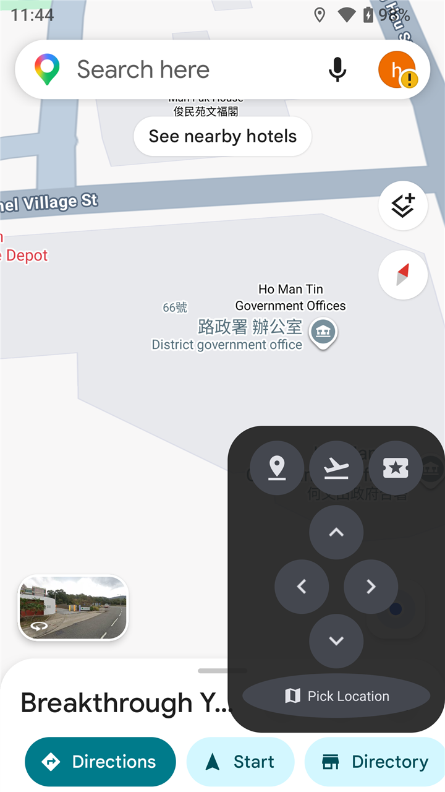
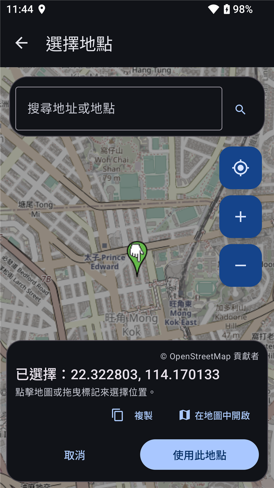

# FakeGPS 2.2.0

Kotlin-first 重構與懸浮窗選點。

## Kotlin 重構

- 專案改為 **100% Kotlin**（0 個 Java 檔、49 個 Kotlin 檔）。
- 61 個 JVM 測試、`lintDebug` / `lintRelease` 0 errors。
- 保留 `fake_gps.db`、SharedPreferences、9 個語系、minSdk 21 / targetSdk 36。
- 舊版書籤與設定可原地升級保留（Android 15 實測）。
- 定位引擎改為單一長駐 HandlerThread，修正快速 Stop→Start 的競態。
- UI 改用 ViewBinding 與 Activity Result API；書籤資料庫 I/O 移到背景執行緒。

## 新功能

- 懸浮窗底部新增「選擇地點 / Pick Location」按鈕，直接開啟地圖選點。
- 選點後立即套用到目前 mock 位置，並返回原本的 App（已用 Google Maps 實測）。
- 選點時自動隱藏懸浮窗，選點 UI 更精簡。
- 懸浮窗仍可拖曳，但會限制在畫面內。

## 懸浮窗選點教學

1. 啟動模擬定位，切到 Google Maps（或其他 App）。
2. 點擊懸浮面板底部的 **Pick Location**（地圖圖示）。
3. 拖曳／縮放地圖，或使用搜尋，點選目標位置。
4. 按 **使用此地點**；位置立即套用，並返回 Google Maps。
5. FakeGPS 自己的畫面開啟時浮動面板會隱藏，回到其他 App 後會再出現。

> 2.2.0 的懸浮窗按鈕文字顯示英文「Pick Location」，圖示與位置相同；後續版本已改為在地化文字。
>
> 完整圖文教學：[README_CN.md](https://github.com/Miku0139oao/FakeGPS/blob/master/README_CN.md)。

## 安裝

1. 下載 `FakeGPS_v2.2.0.apk`。
2. 在開發人員選項中把「模擬位置應用程式」設為 FakeGPS。
3. 開啟 App，按「開始」。

支援 Android 5.0（API 21）以上。

## 驗證

- Android 15（MuMu）：原地升級保留書籤與設定、FGS、mock GPS/NETWORK、fly、書籤 CRUD、地圖搜尋、懸浮窗選點流程。
- R8 release（debug 簽章）實機驗證；本 APK 以 release keystore 簽章。
- APK SHA-256：`e00ee89b8d45372b68f2952e582d0e6806840a1f0f0c94a5286ac5db0f5f052c`
